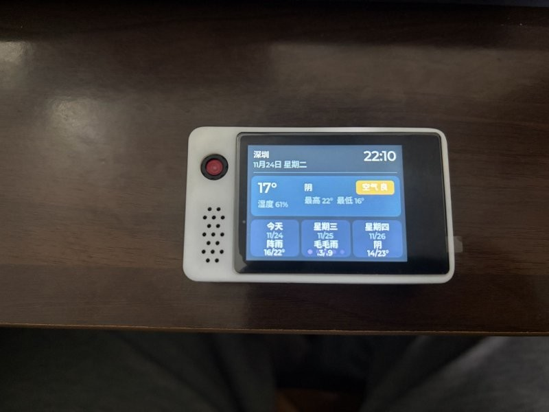
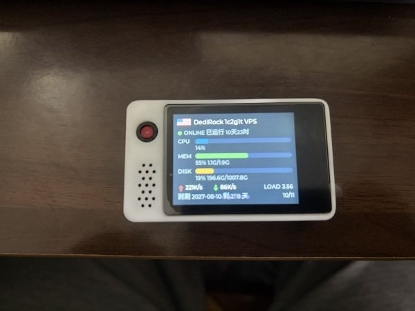
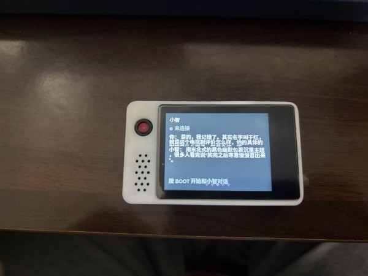
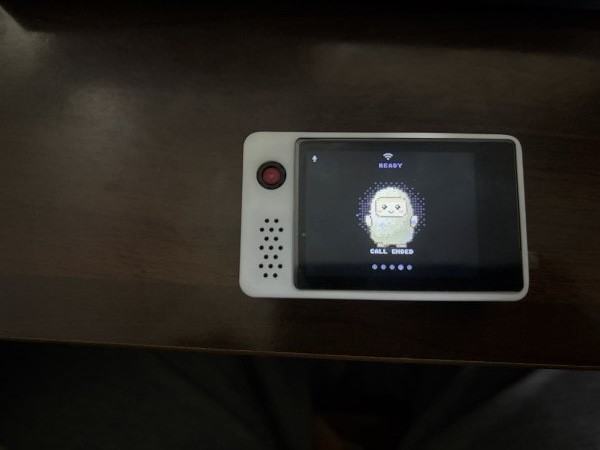
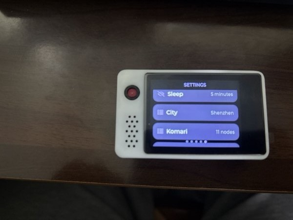

# Muse Gadget on 立创·实战派 ESP32-S3 (lichuang-dev)

A board port of Meta's [muse-gadget-sdk](https://github.com/facebookincubator/muse-gadget-sdk)
(ESP32 Device SDK, Apache-2.0) for the LCKFB 立创·实战派 ESP32-S3 development
board (xiaozhi board name `lichuang-dev`, board id `lichuang_dev`), plus a
spoken-reply TTS wiring. Everything else is upstream.

## Live photos

<p align="center">
  
  
  
  
  
</p>
<p align="center"><sub>The board running v1.0.0: home (weather clock), Komari, Xiaozhi, Muse, Settings.</sub></p>

## Board

ESP32-S3R8 (16 MB flash, 8 MB octal PSRAM), 320x240 ST7789 LCD (CS on a
PCA9557 expander, backlight GPIO42 inverted), FT6336 touch, ES8311 playback
codec + ES7210 dual mic, GC0308 camera (not wired in this tree, see Status).

## Changes vs upstream

- `esp32/components/muse/boards/board_lichuang_dev.c` — the board port
  (display, touch, dual-codec audio, BOOT button), registered as
  `MUSE_BOARD_LICHUANG_DEV` in Kconfig/CMakeLists, the esp_lvgl_adapter
  component rule, and the `tools/muse/` helper maps.
- `esp32/devices/sdkconfig.muse-lichuang-dev` — build profile
  (`tools/muse/board.sh build lichuang`), with realtime voice enabled.
- `esp32/components/muse/muse_chat_session.cpp` — `start_tts` wired to
  Volcano Engine Doubao TTS (v3 unidirectional HTTP, MP3 streamed into the
  stock decoder): voice-note replies are spoken aloud. Configured by
  `MUSE_TTS_VOLCANO_API_KEY` / `_RESOURCE_ID` / `_SPEAKER` in Kconfig.

## Secrets — read before committing

- The committed overlay ships with `CONFIG_MUSE_TTS_VOLCANO_API_KEY=""`.
  Fill the key only in your local copy; never commit a filled value.
- The Gadget SDK token is never in this tree: send it over serial after
  flashing (`>sdk_token=...`), or set it in the build dir's sdkconfig
  (build dirs are gitignored).

## Build & flash

Requires ESP-IDF **v6.0.3** exactly.

```sh
cd esp32
tools/muse/board.sh build lichuang
tools/muse/board.sh flash lichuang /dev/cu.usbmodem112301   # port varies
```

Pairing: Muse app → Settings → Devices → Developer mode → Add Device →
`MuseGadget-XXXXXX`, confirm with a BOOT press. The board talks to the
Muse account it is paired with.

## Status (2026-11-25)

- Working: display, touch, voice notes with spoken replies (Volcano
  seed-tts-2.0, speaker 小何2.0), settings, Wi-Fi provisioning via the
  app, realtime voice calls.
- Home page (added 2026-11-23): the default boot/idle tile shows the
  time and date plus Open-Meteo weather (current temperature, humidity,
  high/low, 3-day forecast) and air quality (US AQI); the avatar tile
  auto-slides back to it after 45 s idle. Chinese text uses Noto Sans SC.
  A row of status icons sits left of the clock (added 2026-11-25):
  Wi-Fi, Bluetooth, speaker, microphone, camera, SD card — lit when
  available, greyed out when off or not yet available; camera and SD
  card are placeholders for now. The icons are pre-rendered bitmaps
  (LVGL symbol glyphs do not render in this build's font); lit and
  faint are separate bitmaps.
- The weather city is switchable in Settings → City (20 cities,
  persisted in NVS); Shanghai is the default.
- Komari server page (added 2026-11-24): a tile between the home page
  and the avatar that rotates through the servers of a Komari panel:
  country flag, online state, CPU/memory/disk bars, up/down rates,
  load, and plan days left. It rotates every 10 s by default; tap for
  the next node. The panel URL and rotation interval are configurable
  in Settings → Komari (persisted in NVS). Flags are pre-rendered
  bitmaps (58 countries); the rate arrows are drawn red/green bitmaps
  (no available font carries arrow glyphs).
- Xiaozhi page (added 2026-11-24): a tile between Komari and the
  avatar that runs a Xiaozhi voice-agent session (protocol v1) against
  the official service by default; Settings → Xiaozhi can point it at
  a self-hosted server. BOOT starts/ends the conversation while the
  tile is showing — the talk-button hooks form a chain, one per page.
  An unbound device shows its activation code on the tile and keeps
  re-polling until it is bound in the Xiaozhi console. The page
  shares the avatar page's vertical volume swipe.
- Komari page updates: BOOT on the tile forces an immediate refresh
  (state line shows it is refreshing); a fetch cycle now reuses one
  keep-alive connection, fetches the on-screen node first, and
  renders each node as its data lands.
- Muse link and memory work: the setup/helper tasks and the page
  fetch tasks run on PSRAM stacks, mbedTLS allocates in PSRAM with
  dynamic record buffers, and the LVGL draw buffer is halved so the
  link registration clears its DMA headroom gate — the device now
  registers fully and the raw tunnel comes up. First page fetches
  are staggered at boot, and the avatar tile shows a
  "Server asleep, reconnecting..." hint (in English since 2026-11-25)
  when Wi-Fi is up but the Muse link stays down (the account's
  VM suspends when idle; the board reconnects on its own once it is
  back).
- Photo notes (GC0308): a backend was written
  (`boards/lichuang_camera.c`, esp32-camera) and then parked on
  2026-11-23 before hardware verification; it is not in this tree.
