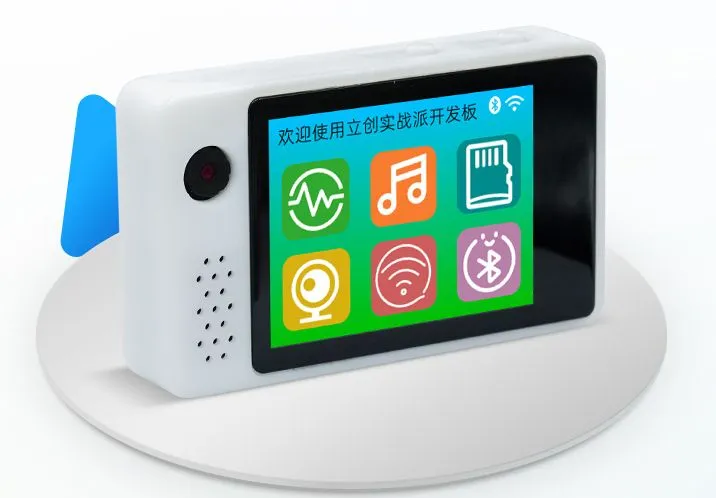
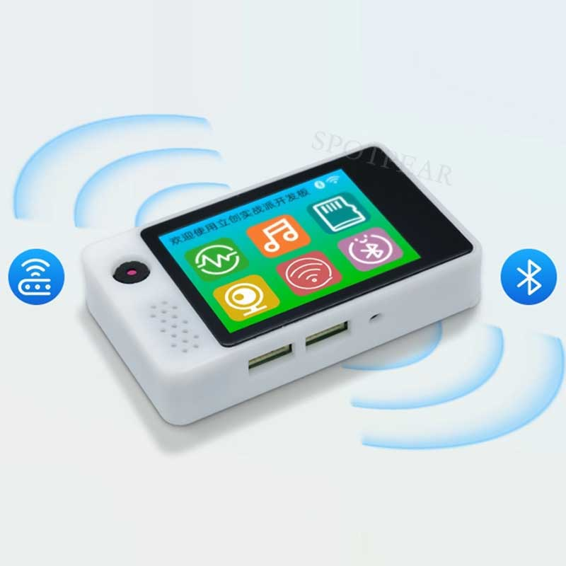

<!--
SPDX-License-Identifier: Apache-2.0

This repository is a third-party board port of Meta's muse-gadget-sdk
(Apache License 2.0). It is not an official Meta project and is not
affiliated with or endorsed by Meta Platforms, Inc. Upstream code and
documentation remain under their original Apache-2.0 license and
copyright notices (see LICENSE).
-->

# Muse Gadget on 立创·实战派 ESP32-S3 (lichuang-dev)

把 Meta 的 [muse-gadget-sdk](https://github.com/facebookincubator/muse-gadget-sdk)（ESP32 Device SDK，Apache-2.0）移植到**立创·实战派 ESP32-S3** 开发板（小智板名 `lichuang-dev`，board id `lichuang_dev`），并为语音留言回复接上火山豆包 TTS 朗读。本仓库是个人移植项目，与 Meta 无隶属或背书关系；英文说明见 [README-lichuang.md](README-lichuang.md)。

<p align="center">
  
  
</p>
<p align="center"><sub>立创·实战派 ESP32-S3 开发板产品图</sub></p>

## 板子

ESP32-S3R8（16 MB flash，8 MB octal PSRAM），320×240 ST7789 LCD（片选在 PCA9557 扩展器上，背光 GPIO42 反相），FT6336 触摸，ES8311 播放 codec + ES7210 双麦，GC0308 摄像头（本树未接入，见下方状态）。

## 相对上游的改动

- `esp32/components/muse/boards/board_lichuang_dev.c` —— 板级移植（显示、触摸、双 codec 音频、BOOT 键），并注册进 Kconfig / CMakeLists、`esp_lvgl_adapter` 组件规则和 `tools/muse/` 辅助映射。
- `esp32/devices/sdkconfig.muse-lichuang-dev` —— 构建 profile（`tools/muse/board.sh build lichuang`），开启实时语音。
- `esp32/components/muse/muse_chat_session.cpp` —— 把 `start_tts` 接到火山引擎豆包语音合成（v3 单向 HTTP，MP3 流式喂给自带解码器）：语音留言的回复会朗读出来。由 Kconfig 的 `MUSE_TTS_VOLCANO_API_KEY` / `_RESOURCE_ID` / `_SPEAKER` 配置。

其余均为上游原样文件（含上游自带的 README、图片与文档，版权与许可见 `LICENSE` 及各文件头）。

## 密钥——提交前必读

- 仓库里 overlay 的 `CONFIG_MUSE_TTS_VOLCANO_API_KEY=""` 为空。key 只填在本地副本，永远不要把填好的值提交上来。
- Gadget SDK token 不进代码树：刷机后经串口发送（`>sdk_token=...`），或写进构建目录的 sdkconfig（构建目录已被 gitignore）。

## 构建与刷机

需要 ESP-IDF **v6.0.3**（不多不少）。

```sh
cd esp32
tools/muse/board.sh build lichuang
tools/muse/board.sh flash lichuang /dev/cu.usbmodem112301   # 串口按实际设备改
```

配对：Muse app → Settings → Devices → Developer mode → Add Device → `MuseGadget-XXXXXX`，在设备上按键确认。板子与配对它的那个 Muse 账号通信。

## 状态（2026-11-24）

- 可用：显示、触摸、语音留言 + 朗读回复（火山 seed-tts-2.0，音色 小何2.0）、设置、经 app 配网、实时语音通话。
- 首页（2026-11-23 新增）：开机默认页与待机页，显示时间/日期、Open-Meteo 天气（当前温度、湿度、最高/最低、三天预报）与空气质量 AQI；待机 45 秒自动从头像页滑回。中文使用 Noto Sans SC 字体。
- 城市可在设置页切换（Settings → City，20 个城市，存 NVS 持久化），默认上海。
- Komari 服务器页（2026-11-24 新增）：首页与头像页之间的一页，轮播 Komari 面板中的服务器——国旗、在线状态、CPU/内存/磁盘占用条、上下行速率、负载、到期剩余天数；默认 10 秒轮换，点按切下一台。面板地址与轮换间隔可在设置页修改（Settings → Komari，存 NVS 持久化）。国旗为预渲染位图（58 国），网速箭头为绘制的红/绿位图（字体无箭头字形）。
- 小智页（2026-11-24 新增）：Komari 页与头像页之间的一页，跑小智语音会话（协议 v1），默认连官方服务，设置页（Settings → Xiaozhi）可改指自建服务器。本页显示时 BOOT 键开关对话——按键钩子已改为链式、每页一个。未绑定的设备会在本页显示激活码并持续轮询，直到在小智控制台完成绑定。本页同样支持和头像页一样的竖滑调节音量。
- Komari 页更新：本页按 BOOT 立即刷新（状态行会显示刷新中）；一轮拉取改为复用一条 keep-alive 连接，先拉当前显示的节点，每台数据到达即上屏。
- Muse 链路与内存：设置/辅助任务与各页拉取任务的栈移到 PSRAM，mbedTLS 在 PSRAM 分配并使用动态记录缓冲，LVGL 绘图缓冲减半使链路注册能越过 DMA 余量门槛——设备现在能完整注册、原始隧道可通。开机首次拉取错峰进行；WiFi 已通但 Muse 链路长时间未连时，头像页会提示"服务器休眠中"（账号的 VM 空闲会休眠，恢复后板子自动重连）。
- 拍照（GC0308）：后端已写过（`boards/lichuang_camera.c`，esp32-camera），2026-11-23 在硬件验证前暂存回滚，不在本树内。
